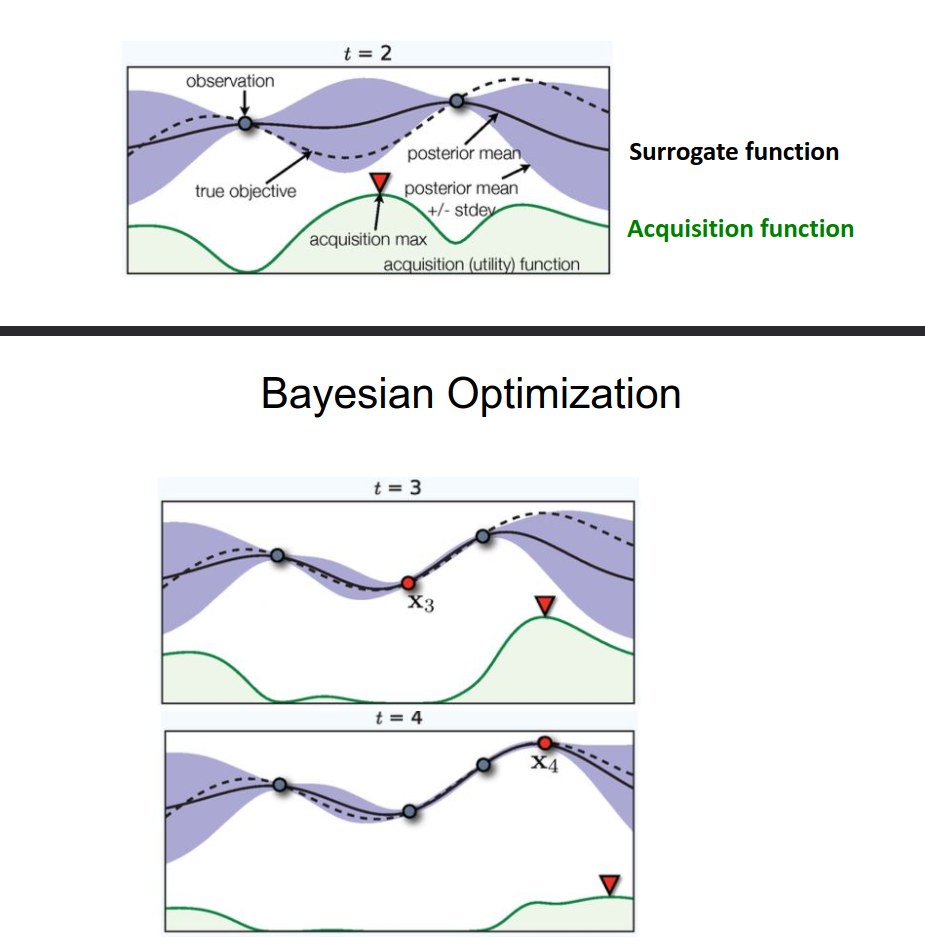

# **ACO (Ant Colony Optmization)**

Algoritmo inspirado no comportamento de formigas que usa algo chamado feromonios para criar uma comunicacao indireta entre as formigas atraves do ambiente (estigmergia), ou seja, uma passagem de informacao. Aqui se usa uma ideia de retroalimentacao positiva em que quanto mais usado uma caminho é, mais atrativo para outras formigas ele se torna. No algortimo cada formiga é um agente que constroi solucoes de forma incremental em um grafo que representa o problema, um caminho nesse grafo representa uma solucao valida e cada aresta nesse grafo tem uma quantidade de feromonio.

Durante a construcao incremental de uma solucao a escolha de qual aresta seguir depende de 2 fatores:

- **Feromonio das arestas candidatas:** Conhecimento global adiquirido através das outras formigas 
- **Heuristica do problema:** Conhecimento local adiquirido do proprio problema

A melhor aresta nao é sempre escolhida pois é um processo probabilistico

## **Exemplo TSP**

O objetivo do problema do caixeiro viajante é encontrar um caminho de custo mínimo que visite todas as cidades exatamente uma vez e retorne à cidade inicial. No ACO, cada formiga constrói um caminho completo, escolhendo uma cidade por vez.

A função heurística poderia ser:
$$
\eta_{ij}=\frac{1}{d_{ij}}
$$

Em que $d_{ij}$ é a distância entre as cidades $i$ e $j$. Por que utilizar o inverso da distância? Porque queremos que arestas menores tenham maior atratividade. Entretanto, escolher sempre a cidade mais próxima não garante o menor caminho global. É justamente por isso que também utilizamos o feromônio. A heurística representa informação local, enquanto o feromônio representa aprendizado global pois melhores solucoes globais vao ter mais feromonios.

## **Como escolher qual aresta seguir ?**

Para escolher qual das arestas possiveis que saem de i seguir decidimos a probabilidade de cada uma delas usando a seguinte equacao:

$$
p_{ij}=
\frac{\tau_{ij}^{\alpha}\eta_{ij}^{\beta}}
{\displaystyle\sum_{k\in N(i)}
\tau_{ik}^{\alpha}\eta_{ik}^{\beta}}
$$

Onde:

- $p_{ij}$	Probabilidade de ir de $i$ para $j$
- $\tau_{ij}$	Feromônio da aresta
- $\eta_{ij}$	Qualidade heurística da aresta
- $\alpha$	Influência do feromônio
- $\beta$	Influência da heurística
- $N(i)$	Conjunto de vizinhos elegíveis (não visitados)

A logica da equacao é simples, o valor da aresta é definido pelo produto do feromonio pela heuristica ponderados pelos seus respectivos pesos. Depois transformamos esse peso em uma probabilidade normalizando pela soma de todos os pesos das arestas que saem de i. Ao final sorteamos um numero e amostramos dessa distribuicao para escolher a aresta... as arestas de maior peso/atratividade tem mais chance.

## **Como atualizar o feromonio durante a otimizacao ?**

Depois que todas as formigas constroem suas soluções, atualizamos o feromônio em duas etapas: evaporação e depósito

### **Evaporação**

$$ \tau_{ij}\leftarrow(1-\rho)\tau_{ij} $$

Onde $\rho$ é a taxa de evaporação:
$$
0<\rho\leq1
$$

Se $\rho=0,2$, por exemplo, significa que 20% do feromônio existente será removido. A evaporação permite que o algoritmo esqueça informações antigas e reduz o risco de convergência prematura para soluções ruins.

### **Depósito**

Cada formiga deposita feromônio nas arestas que utilizou para construir sua solução.

$$
\Delta\tau_{ij}^{k}=
\begin{cases}
\dfrac{1}{f(S_k)},& (i,j)\in S_k\\[6pt]
0,&\text{caso contrário}
\end{cases}
$$

Onde $f(S_k)$ é o **custo total da solução** construída pela formiga $k$. Por que utilizar o inverso do custo? Porque, em um problema de minimização, quanto menor o custo da solução, maior deve ser a recompensa. Uma formiga que encontrou um caminho de custo 10 deposita o dobro do feromônio de outra que encontrou um caminho de custo 20.

### **Equação completa**

Combinando as duas etapas para atualizar uma unica aresta:
$$
\tau_{ij}(t+1)=
(1-\rho)\tau_{ij}(t)
+\sum_{k=1}^{m}\Delta\tau_{ij}^{k}
$$

O primeiro termo representa a memória preservada da iteração anterior. O segundo representa o conhecimento adquirido pelas formigas na iteração atual.


### **Exploration × Exploitation**

No ACO, a escolha probabilística permite exploração, enquanto o reforço de boas soluções através do feromônio favorece intensificação. O equilíbrio é importante porque o algoritmo pode reforçar excessivamente uma solução subótima, dificultando a descoberta de uma solução melhor.


### **Métodos de atualização do feromônio**

- **Tradicional:** Todas as formigas depositam feromônio.
- **Elitista:**	Utiliza a melhor solução encontrada até o momento para reforçar o feromônio, ou seja, as arestas da melhor solucao vao receber um feromonio extra.
- **Rank:**	As soluções são ordenadas e recebem pesos conforme sua classificação.
- **Max-Min:** Somente uma formiga deposita feromônio, e os valores possuem limites inferiores e superiores.

#### **Max-Min**
Dê atenção especial a esse método, pois recebe um slide exclusivo na aula. No Max-Min, impomos a restrição:
$$
\tau_{\min}\leq\tau_{ij}\leq\tau_{\max}
$$

Isso significa que nenhuma aresta pode se tornar excessivamente atrativa ou perder completamente sua atratividade por falta de feromônio, considerando um limite inferior positivo. Apenas a melhor formiga da iteração ou a melhor formiga encontrada desde o início deposita feromônio.

Inicialmente:
$$
\tau_{ij}(0)=\tau_{\max}
$$

A inicialização favorece a exploração, enquanto o reforço seletivo favorece a intensificação nas iterações seguintes.

## **Algoritmo**

```text
Inicializar feromônio de todas as arestas
Inicializar melhor solução

Enquanto não atingir o limite de iterações:

    Para cada formiga:

        Selecionar cidade inicial

        Enquanto existirem cidades não visitadas:
            Calcular probabilidades de transição
            Sortear próxima cidade
            Adicionar cidade à solução

        Retornar à cidade inicial
        Calcular custo total da solução
        Atualizar melhor solução encontrada

    Evaporar feromônio de todas as arestas
    Depositar feromônio conforme as soluções

Retornar melhor solução encontrada
```

# **PSO (Particle Swarm Optmization)** 

PSO é outro algortimo de inteligencia de enxames só que nesse ele funciona de forma diferente do ACO. Aqui temos um conjunto de particulas no espaco em que cada particula representa uma solucao candidata atual, entao se queremos minimizar uma funcao de 2 variaveis nossas particulas sao pontos em 2D (um para cada variavel) em que queremos otimizar esse fitness se movendo no espaco com uma velocidade usando conhecimento global e local.

## **Componentes de uma particula**

Para um problema de D variaveis que queremos otimizar temos para cada particula:

- **Vetor de solucao atual:** Solucao atual de dimensao D
- **Velocidade atual:** Direcao no espaco que atualmente estamos tendendo a avancar para otimizar a fitness
- **Melhor solucao individual:** Vetor de menor fitness ja encontrado por essa particula
- **Melhor solucao global:** Vetor de menor fitness ja encontrado por todas as particulas 

## **Equações do PSO**

### **Atualização da velocidade**

$$
\begin{aligned}
\mathbf{v}_i(t)={}&
\omega\mathbf{v}_i(t-1)\\
&+c_1\phi_1(\mathbf{p}_i-\mathbf{x}_i(t-1))\\
&+c_2\phi_2(\mathbf{p}_g-\mathbf{x}_i(t-1))
\end{aligned}
$$

A equação é composta por três termos: inércia, componente cognitivo e componente social.

- *Inércia:* Representa a tendência da partícula de continuar seu movimento anterior. O parâmetro $\omega$ determina quanto da velocidade anterior será preservado.

- **Componente cognitivo:* A diferença entre a melhor posição individual e a posição atual produz um vetor que aponta em direção ao pBest. Esse vetor indica a direção em que a partícula deve se mover para retornar à sua melhor posição histórica

- *Componente social:* Possui a mesma lógica do componente cognitivo, mas direciona a partícula para a melhor solução conhecida coletivamente.

Os parâmetros $c_1$ e $c_2$ controlam a importância de cada componente. Os fatores $\phi_1$ e $\phi_2$ são taxas de aprendizagem, usualmente sorteadas no intervalo $[0,1]$ no PSO convencional.

### **Atualização da posição**

Depois de calcular a nova velocidade, atualizamos a posição:
$$\mathbf{x}_i(t)=\mathbf{x}_i(t-1)+\mathbf{v}_i(t)
$$

### **Influência dos parâmetros**

#### **Inércia ($\omega$)**

A inércia controla quanto do movimento anterior é preservado. Uma possivel estrategia usando ela é o decaimento linear ao longo das iteracoes. Dessa forma, no inicio teriamos maior exploracao pois a direcao anterior teria muito peso e portanto explorariamos pouco a direcoes melhores, ao final com a inercia pequena focamos em usar mais o conhecimento dos melhores.

#### **Coeficientes cognitivo e social**

Um valor elevado de $c_1$, relativamente a $c_2$, tende a preservar a independência das partículas, enquanto um valor elevado de $c_2$, relativamente a $c_1$, tende a concentrá-las nas melhores regiões conhecidas pelo grupo.

### **Exploration X Explotation**

- *Favorece exploração:* Maior inércia, Maior influência individual relativa, Mutação das partículas

- **Favorece explotation:** Menor inércia, Maior influência social relativa, Concentração nas melhores soluções

O excesso de explotation pode provocar convergência prematura, situação em que as partículas se concentram em um ótimo local e perdem diversidade antes de encontrar o ótimo global

### **Fator de constrição ($\chi$)**

O fator de constrição $\chi$ é uma alternativa a inércia para reduzir o numero de parametros e é calculado a partir dos coeficientes cognitivo e social.

$$
\chi=\frac{2}
{\left|2-\beta-\sqrt{\beta^2-4\beta}\right|}
$$

Onde:
$$
\beta=c_1+c_2
$$

A atualização apresentada no PDF é:
$$
\begin{aligned}
\mathbf{v}_i(t)={}&
\chi\mathbf{v}_i(t-1)\\
&+c_1\phi_1(\mathbf{p}_i-\mathbf{x}_i)\\
&+c_2\phi_2(\mathbf{p}_g-\mathbf{x}_i)
\end{aligned}
$$

A finalidade é controlar a dinâmica das partículas e favorecer a convergência do enxame.

### **Limitação da velocidade**

Outro mecanismo utilizado para controlar o deslocamento das partículas é limitar a velocidade máxima.
$$-V_{\max}\leq v_{ij}\leq V_{\max}
$$

Para cada dimensão da partícula:
$$
v_{ij}\leftarrow
\begin{cases}
V_{\max},&v_{ij}>V_{\max}\\
-V_{\max},&v_{ij}<-V_{\max}\\
v_{ij},&\text{caso contrário}
\end{cases}
$$

A limitação reduz o risco de deslocamentos excessivos, mas não garante, sozinha, que a posição permaneça dentro do espaço de busca. Também pode ser necessário tratar os limites da posição

## **Topologias de comunicacao com vizinhança**


A vizinhança determina com quais partículas um indivíduo compartilha informações. Existem dois conceitos de distância: 

- *Geográfica:* Baseada na proximidade das partículas no espaço de busca, podendo utilizar a distância euclidiana.
- *Social:* Baseada nas conexões entre partículas, independentemente de suas posições no espaço de busca.

Uma partícula pode estar distante de outra no espaço de busca, mas ainda assim ser sua vizinha social.

### **Principais topologias**

- *Estrela (global):* Todas as partículas se comunicam entre si.Tem convergência mais rápida e possivelmente prematura pois a melhor solucao fica disponivel para todos.

- *Anel:* Cada partícula se comunica normalmente com dois vizinhos. Cobre melhor o espaco de busca pela limitacao de informacao mas converge mais lentamente.

- *Focal (Wheel):* Existe uma partícula central responsável pela comunicação entre os demais indivíduos. A informação passa pelo ponto focal, em vez de ser compartilhada diretamente entre todas as partículas.

- *Von Neumann:* As partículas são organizadas em uma grade, com quatro vizinhos por partícula. A aula destaca seu bom desempenho empírico em diversos problemas.

## **Algortimo**

```text
Inicializar posições e velocidades aleatoriamente

Avaliar a fitness das partículas
Inicializar pBest de cada partícula
Inicializar gBest do enxame

Enquanto o critério de parada não for satisfeito:

    Para cada partícula:

        Calcular nova velocidade

        Limitar velocidade, se necessário

        Calcular nova posição

        Avaliar fitness da nova posição

        Se a nova posição for melhor que pBest:
            Atualizar pBest

        Se a nova posição for melhor que gBest:
            Atualizar gBest

Retornar gBest
```

### **Metodos hibridos**

- *PSO com seleção:* as partículas são classificadas de acordo com seu desempenho. A metade com pior desempenho é substituída pela melhor metade, preservando as memórias individuais conforme o algoritmo apresentado.

- *PSO com mutação gaussiana:* adicionamos uma perturbação aleatória à posição das partículas após sua atualização. Algumas versões aplicam a mutação apenas à melhor solução global.

# **Otimizacao de Hiperparametros (HPO)**

Objetivo é encontrar automaticamente configurações de hiperparâmetros que produzam modelos de aprendizado de máquina com melhor desempenho

- *Parâmetros* são valores aprendidos durante o treinamento de um modelo como regras em uma arvore ou pesos em modelos neurais
- *Hiperparâmetros* são configurações definidas antes do treinamento que influenciam o processo de aprendizagem ou a estrutura do modelo como profundidade maxima em arvores e numero de camadas em redes

Existem diferentes niveis de automatizacao:

- HPO escolhe hiperparâmetros de um algoritmo.
- Seleção de algoritmos	escolhe qual algoritmo utilizar.
- Uma abordagem combinada escolhe algoritmo e seus hiperparâmetros.
- AutoML escolhe composição e configuração de pipelines completos.

## **Formulacao**

Podemos escrever a função objetivo como:
$$
\Psi(\lambda)=
\frac{1}{|D_{\mathrm{valid}}|}
\sum_{x\in D_{\mathrm{valid}}}
\mathcal{L}\left(x,
\mathcal{A}_{\lambda}(D_{\mathrm{train}})\right)
$$

E o problema de otimização como:
$$\lambda^*=\arg\min_{\lambda\in\Lambda}\Psi(\lambda)
$$ 

Onde:

- $\lambda$: Vetor de hiperparâmetros
- $\Lambda$: Espaço de configurações possíveis
- $\mathcal{A}_{\lambda}$: Algoritmo configurado com $\lambda$
- $D_{\mathrm{train}}$: Conjunto de treinamento
- $D_{\mathrm{valid}}$: Conjunto de validação
- $\mathcal{L}$: Função de perda
- $\Psi(\lambda)$: Perda média na validação
- $\lambda^*$: Configuração ótima

A lógica é: 
1. Primeiro, escolhemos uma configuração de hiperparâmetros $\lambda$.

2. Depois, treinamos o modelo utilizando essa configuração:
$
M_\lambda=\mathcal{A}_\lambda(D_{\mathrm{train}})
$

3. Em seguida, calculamos sua perda média no conjunto de validação:
$
\Psi(\lambda)=
\frac{1}{|D_{\mathrm{valid}}|}
\sum_{x\in D_{\mathrm{valid}}}
\mathcal{L}(x,M_\lambda)
$

4. Finalmente, procuramos a configuração que minimiza essa perda. Como geralmente não conseguimos avaliar todas as configurações possíveis, retornamos a melhor entre as $S$ configurações efetivamente avaliadas:
$$
\hat{\lambda}=
\arg\min_{\lambda\in\{\lambda^{(1)},\ldots,\lambda^{(S)}\}}
\Psi(\lambda)
$$

## **Grid Search**

O Grid Search (busca em grade) discretiza cada hiperparâmetro em um conjunto de valores e testa todas as combinações possíveis.

Por exemplo, considere uma SVM com dois hiperparâmetros:
$$
C\in\{0,1;\ 1;\ 10\}
$$

$$
\sigma\in\{0,01;\ 0,1;\ 1\}
$$

O Grid Search avaliará as nove combinações possiveis. Se cada hiperparâmetro d possui uma quantidade diferente de valores possiveis temos a seguinte quantidade de possibilidades:

$$N=\prod_{i=1}^{d}k_i
$$

Sua principal vantagem é que é simples, facil de paralelizar e pode ser muito util quando existe conhecimento especializado para delimitar os parametros. Entretanto, seu custo é exponencial, gasta computacao em regioes claramente ruins de forma cega e é limitado a encontrar apenas as melhores solucoes dentro da grade discretizada.

## **Random Search**

O Random Search (busca aleatória) seleciona configurações aleatoriamente dentro do espaço de hiperparâmetros. Em vez de testar todas as combinações possíveis, definimos um orçamento de $N$ avaliações.

#### **Por que o Random Search pode ser melhor que o Grid Search, mesmo sendo aleatório?**

A dimensionalidade efetiva representa a quantidade de dimensões que realmente influenciam significativamente a função objetivo. *Na realidade poucos hiperparâmetros são realmente relevantes para determinado dataset, e os hiperparâmetros relevantes podem mudar de um dataset para outro.* A busca aleatória pode permitir explorar diversas regioes e com alta probabilidade encontrar pelo menos uma solucao boa conforme amostramos mais e conforme a proporcao da dimensionalidade efetiva aumenta.

## **Bayesian Optimization (BO)**

Tanto Grid Search quanto Random Search são classificados como métodos cegos (blind methods), pois não utilizam os resultados anteriores para orientar a escolha das próximas configurações. A Otimização Bayesiana procura utilizar as avaliações anteriores para *escolher de maneira inteligente a próxima configuração* de hiperparâmetros.

Ela é especialmente adequada para funções objetivo:
- Caixa-preta (black-box)
- Computacionalmente caras
- Multimodais, ou seja, com múltiplos ótimos locais
- Possivelmente ruidosas

### **O que é uma função caixa-preta?**

Uma função caixa-preta é uma função cuja expressão analítica não conhecemos e cujas derivadas não estão diretamente disponíveis.

Por exemplo:
$$
f(\lambda)=\text{erro de validação da rede neural}
$$

Não temos uma equação explícita relacionando com pesos e constantes o número de camadas, o learning rate e os demais hiperparâmetros ao erro final. Para descobrir $f(\lambda)$, precisamos efetivamente treinar e avaliar o modelo.

Se avaliar a função objetivo for barato, podemos testar muitas configurações. Entretanto, se cada avaliação demorar horas, precisamos reduzir a quantidade de avaliações. É nesse cenário que a Otimização Bayesiana se torna interessante.

### **Componentes da Otimizacao Bayesiana**

È composto por 2 componentes principais:

- *Surrogate Model:* O proprosito aqui é estimar o desempenho de uma determinada combinação de solução (hiperparametros) e junto ter a incerteza dessa estimativa.
    - Quão boa deteminada combinação é ? quanto de certeza temos nisso ?

- *Aquisition Function:* Decide para onde seguir na exploração do espaço
    - Qual a proxima combinação/solução devemos testar ?



A grande vantagem é que avaliar o modelo surrogate para ter uma estimativa de qualidade é muito mais barato do que treinar o modelo e conseguir esse valor real. Então podemos escolher regiões especificas de maior potencial para treinar e alimentar os modelos com valores reais e assim reduzir incertezas de outras regiões.

### **Algortimo da Otimização Bayesiana**

1. Inicialmente executamos o modelo com algumas soluções iniciais (Hiperparametros) e conseguimos uma amostra diversa de varios pontos no espaço e suas respectivas losses/perdas reais (ou seja, incerteza 0 nesses pontos pois são reais da função objetivo). O objetivo aqui é conhecer um pouco outputs da função objetivo para aprender a estimar.

2. Ajustamos o modelo surrogate nessas observações para ele aprender a estimar a função objetivo e a incerteza das estimativas.

3. Utilizamos a função de aquisição para determinar o proximo ponto/solução devemos explorar. Essa decisão é baseada na estimativa de qualidade do sorrogate e da incerteza associada.

4. Treinamos o modelo real com hiperparametros escolhidos pela aquisição, ou seja, conseguimos o valor real da função objetivo para aquela instancia com potencial.

5. Adicionamos esse novo resultado real da função objetivo junto das soluções iniciais executadas. Atualizamos/treinamos o sorrogate com essa nova informação e repetimos o processo por N iterações em que N é o orçamento.

```text
Realizar algumas avaliações iniciais
Armazenar configurações e resultados

Enquanto houver orçamento de avaliações:

    Ajustar modelo substituto
    Estimar função objetivo e incerteza das previsões

    Construir função de aquisição

    Encontrar configuração que maximiza
    a função de aquisição

    Treinar modelo com essa configuração
    Avaliar seu desempenho real

    Adicionar resultado às observações
    Atualizar melhor configuração encontrada

Retornar melhor configuração encontrada
```

### **Processo Gaussiano (GP)**

Na formulação original de OB, é utilizado como surrogate model um processo gaussiano. Um GP ao invés de prever um valor estimado como em uma regressão, ele estima uma distribuição de valores plausiveis para aquela predição assumindo que se comporta como uma gaussiana com media e desvio padrão definidos. Isso nos entrega a estimativa e a incerteza de uma unica vez.

#### **Exploration x Explotation**

Na Otimização Bayesiana, esse equilíbrio ocorre principalmente por meio da função de aquisição.

- **Exploration:** avaliar regiões com alta incerteza, mesmo que sua média prevista não seja tão promissora.
- **Exploitation:** avaliar regiões nas quais o modelo prevê bons resultados.

Se escolhermos sempre o ponto com melhor média prevista, podemos ficar presos em um ótimo local. Se escolhermos sempre os pontos com maior incerteza, podemos desperdiçar avaliações em regiões ruins.

### **Expected Improvement (EI)**

Como função de aquisição é utilizada geralmente o ganho esperado de um ponto. A ideia é escolher o ponto que possui a maior expectativa de melhorar a melhor solução encontrada até o momento.


# **CMA-ES (Covariance Matrix Adaptation Evolution Strategy)**

CMA-ES é uma meta-heuristica para otimização continua e diferentemente do PSO, que movimenta partículas pelo espaço de busca, o CMA-ES aprende uma distribuição de probabilidade que gera soluções cada vez mais promissoras.

## **Estrategias evolutivas** 

Inicialmente algortimos evolutivos chamados de estrategias evolutivas tinham apenas um unico individuo e a ideia é aplicar pequenas perturbações aleatórias nesse indivíduo, gerando novas soluções, e selecionar aquelas com melhor fitness. Ao longo do desenvolvimento das estratégias evolutivas, foram incorporados mecanismos de população, recombinação, seleção e adaptação dos parâmetros de mutação.

### **Estratégias de seleção Plus e Comma**

Utilizando a notação mais comum na literatura:

- $\mu$: número de pais ou indivíduos selecionados.
- $\lambda$: número de descendentes gerados.

Existem dois esquemas principais de estrategias e quem compete para sobreviver:

- **$(\mu+\lambda)$-ES:** Pais e descendentes
- **$(\mu,\lambda)$-ES:** Apenas descendentes


### **Plus Strategy $(\mu+\lambda)$**

Os pais competem com seus descendentes. Selecionamos os melhores indivíduos da união das duas populações.
$$
P_{t+1}=\operatorname{Best}_{\mu}(P_t\cup P_{\mathrm{filhos}})
$$
Essa estratégia possui elitismo, pois uma boa solução pode sobreviver por diversas gerações.

### **Comma Strategy $(\mu,\lambda)$**

Os pais são descartados e apenas os descendentes participam da seleção.

$$
P_{t+1}=\operatorname{Best}_{\mu}(P_{\mathrm{filhos}})
$$
Isso permite que a população aceite temporariamente soluções piores, o que pode ajudar a escapar de ótimos locais.

### **Mutação gaussiana**

A operação fundamental das estratégias evolutivas é:
$$ x'=x+\sigma z$$

Onde:
- $z\sim\mathcal{N}(0,1)$
- $x$	Solução original
- $x'$	Solução após a mutação
- $z$	Número aleatório normal padrão
- $\sigma$	Tamanho do passo de mutação (step-size)


A distribuição normal padrão possui média zero e variância unitária:
$$
\mathbb{E}[z]=0
$$
$$
\operatorname{Var}(z)=1
$$
Portanto:
$$
\mathbb{E}[x']=x
$$
E:
$$
\operatorname{Var}(x')=\sigma^2
$$
Isso significa que as novas soluções são geradas ao redor da solução original, e $\sigma$ controla o quanto elas podem se afastar.

### **Influência do tamanho do passo**

- *Pequeno:* Pequenas mutações e busca local
- *Grande:* Grandes mutações e exploração
- *Zero:* Nenhuma alteração

O problema das primeiras estratégias evolutivas era justamente manter esse parâmetro constante durante a busca

### **Regra de sucesso de 1/5**

Uma das primeiras estratégias utilizadas para adaptar o tamanho do passo é a 1/5 success rule. A ideia é modificar $\sigma$ de acordo com a proporção de mutações bem-sucedidas nas últimas $k$ iterações.

$$
p_s=\frac{\text{número de mutações bem-sucedidas}}
{\text{número total de mutações}}
$$

Uma mutação é considerada bem-sucedida quando melhora a solução.

A regra de atualização é:
$$
\sigma\leftarrow
\begin{cases}
\sigma/\alpha,&p_s>1/5\\[4pt]
\sigma\alpha,&p_s<1/5\\[4pt]
\sigma,&p_s=1/5
\end{cases}
$$

Se mais de 20% das mutações são bem-sucedidas, podemos aumentar o tamanho do passo, pois a busca está conseguindo produzir melhorias com frequência. Se menos de 20% são bem-sucedidas, diminuímos o tamanho do passo, pois as mutações podem estar sendo excessivamente grandes.

## **O que é o CMA-ES?**

A principal inovação do CMA-ES é que o algoritmo não adapta as dimensões de forma independente e sem relação ou a magnitude das mutações (passo). O CMA-ES aprende as dependências entre as variáveis do problema sem precisar conhecer sua função analítica ou suas derivadas.

Para isso, utiliza uma distribuição normal multivariada:
$$
\mathbf{x}\sim\mathcal{N}(\mathbf{m},\sigma^2\mathbf{C})
$$

Onde:

- $\mathbf{m}$ de tamanho n que são as medias das dimensões
- $\sigma$ que é o tamanho global do passo da mutação
- $\mathbf{C}$ de tamanho $n\times n$ como as dimensões se afetam
- $\mathbf{x}$ de tamanho $n$ que é a solução candidata

Os três elementos são adaptados ao longo da execução. Para um problema bidimensional:
$$
\mathbf{C}=
\begin{bmatrix}
\operatorname{Var}(x_1)&\operatorname{Cov}(x_1,x_2)\\
\operatorname{Cov}(x_2,x_1)&\operatorname{Var}(x_2)
\end{bmatrix}
$$

Os elementos da diagonal representam as variâncias. Os elementos fora da diagonal representam as covariâncias entre as variáveis.

## **Funcionamento geral do CMA-ES**

O CMA-ES mantém uma distribuição parametrizada por:

$$
\theta=\{\mathbf{m},\mathbf{C},\sigma\}
$$

Em cada geração, realiza três operações fundamentais: amostragem de soluções, avaliação e atualização da distribuição. Inicialmente, geralmente temos:
$$
\mathbf{C}^{(0)}=\mathbf{I}
$$

Isso representa a ausência de conhecimento inicial sobre as covariancias

### **Amostragem das soluções** 

Em cada geração são produzidas $\lambda$ soluções candidatas:

$$
\mathbf{x}_i=\mathbf{m}+\sigma\mathbf{y}_i
$$

Onde:
$$
\mathbf{y}_i\sim\mathcal{N}(\mathbf{0},\mathbf{C})
$$
Equivalentemente:
$$
\mathbf{x}_i\sim\mathcal{N}(\mathbf{m},\sigma^2\mathbf{C})
$$

### **Seleção e atualização da média**

Após gerar $\lambda$ soluções, avaliamos suas funções objetivo. Para um problema de minimização, ordenamos:

$$
f(\mathbf{x}_{1:\lambda})
\leq
f(\mathbf{x}_{2:\lambda})
\leq\cdots\leq
f(\mathbf{x}_{\lambda:\lambda})
$$

A notação $\mathbf{x}_{i:\lambda}$ representa a i-ésima melhor solução entre as $\lambda$ soluções geradas. Selecionamos as $\mu$ melhores e calculamos uma média ponderada:

$$
\mathbf{m}_{novo}
=
\sum_{i=1}^{\mu}
w_i\mathbf{x}_{i:\lambda}
$$

Onde:
$$
w_1\geq w_2\geq\cdots\geq w_\mu>0
$$
$$
\sum_{i=1}^{\mu}w_i=1
$$

As melhores soluções recebem pesos maiores.

### **Adaptação da matriz de covariância**

Existem 2 formas principais

#### **Rank-one**

$$
\mathbf{C}_{novo}
=
(1-c_{\mathrm{cov}})\mathbf{C}
+
c_{\mathrm{cov}}\mu_w
\mathbf{y}_w\mathbf{y}_w^T
$$

Onde:

- $\mathbf{C}:$ Matriz de covariância anterior
- $c_{\mathrm{cov}}:$ Taxa de aprendizagem da covariância
- $\mathbf{y}_w$: Direção média ponderada das novas soluções amostradas do passo anterior
- $\mu_w$: Massa efetiva de seleção (hiperparametro)


O primeiro termo preserva parte da informação anterior. O segundo incorpora informações sobre a direção bem-sucedida atual. Essa lógica é semelhante à atualização de feromônio do ACO: preservamos parte do conhecimento passado e reforçamos informações promissoras.

#### **Rank-$\mu$ Update**

Enquanto o Rank-One utiliza uma direção agregada, o Rank-$\mu$ utiliza individualmente os deslocamentos das $\mu$ melhores soluções.

Primeiramente, construímos:
$$
\mathbf{C}_\mu=
\sum_{i=1}^{\mu}
w_i\mathbf{y}_{i:\lambda}
\mathbf{y}_{i:\lambda}^T
$$

Depois, atualizamos:
$$
\mathbf{C}_{novo}
=
(1-c_{\mathrm{cov}})\mathbf{C}
+c_{\mathrm{cov}}\mathbf{C}_\mu
$$

Essa estratégia aproveita mais informações de cada geração, sendo particularmente interessante para populações maiores.

#### **Atualização completa**

O CMA-ES completo combina as duas estratégias.


$$
\begin{aligned}
\mathbf{C}\leftarrow{}&
(1-c_1-c_\mu)\mathbf{C}\\
&+c_1\mathbf{p}_c\mathbf{p}_c^T\\
&+c_\mu\sum_{i=1}^{\mu}
w_i\mathbf{y}_{i:\lambda}
\mathbf{y}_{i:\lambda}^T
\end{aligned}
$$

em que c1 controla o peso do rank-one e o segundo o peso do rank-mu

### **Controle do tamanho do passo (Step-size control)**

Uma pergunta natural seria: se a matriz de covariância já controla a dispersão da distribuição, por que precisamos de $\sigma$? Porque a matriz de covariância é especialmente útil para aprender a forma e as direções da distribuição, enquanto $\sigma$ permite aumentar ou diminuir globalmente a magnitude dos deslocamentos.

#### **Efeito do tamanho do passo**

- Se $\sigma$ for muito pequeno, o algoritmo fará movimentos muito curtos e terá dificuldade para explorar novas regiões.

- Se $\sigma$ for muito grande, as soluções serão excessivamente dispersas, dificultando o refinamento.

Portanto, existe um compromisso entre exploration e exploitation.

### **Algortimo**

```text
Inicializar média m
Inicializar tamanho do passo σ
Inicializar matriz de covariância C = I
Inicializar caminhos evolutivos com zero

Enquanto o critério de parada não for satisfeito:

    Gerar λ soluções da distribuição normal

    Avaliar a fitness das soluções

    Ordenar as soluções pela fitness

    Selecionar as μ melhores soluções

    Atualizar média por recombinação ponderada

    Atualizar caminhos evolutivos

    Atualizar matriz de covariância:
        Rank-One
        Rank-μ

    Atualizar tamanho do passo σ

    Registrar melhor solução encontrada

Retornar melhor solução encontrada
```

# **NAS (Neural Architeture Search)**

Uma das principais contribuições do Deep Learning foi automatizar o processo de engenharia de atributos (feature engineering). Entretanto, surgiu outro problema: a necessidade de projetar manualmente arquiteturas cada vez mais complexas.O NAS procura automatizar essa segunda tarefa, chamada de architecture engineering.

## **Componentes principais de um NAS**

Um metodo NAS geralmente tem 3 componentes:

- *Search Space:* Quais arquiteturas podem ser construídas? Aqui limitamos as possibilidades
- *Search Strategy:* Como encontrar boas arquiteturas? Aqui procuramos
- *Performance Estimation Strategy:* Como avaliar a qualidade das arquiteturas? Aqui estimamos

### **Formulação** 

podemos formular o NAS como:
$$
A^*=\arg\min_{A\in\mathcal{A}}
\mathcal{L}_{valid}(A,w^*(A))
$$
Onde:
- $\mathcal{A}$ é o espaço de arquiteturas possíveis.
- A é uma arquitetura candidata.
- $w^*(A)$ são os pesos obtidos pelo treinamento da arquitetura.
- $\mathcal{L}_{valid}$ é a perda no conjunto de validação.

Os pesos são obtidos resolvendo outro problema de otimização:
$$
w^*(A)=
\arg\min_w\mathcal{L}_{train}(A,w)
$$

Substituindo essa expressão na primeira equação:
$$
A^*=
\arg\min_{A\in\mathcal{A}}
\mathcal{L}_{valid}
\left(
A,\arg\min_w\mathcal{L}_{train}(A,w)
\right)
$$

Observe que existem dois problemas de otimização: um interno, responsável pelo treinamento dos pesos, e um externo, responsável pela escolha da arquitetura. Isso explica por que o NAS é computacionalmente caro: para avaliar uma arquitetura, potencialmente precisamos treinar uma rede neural inteira.

### **Search Space** 

O espaço de busca define todas as arquiteturas que o algoritmo consegue representar. Quanto mais abrangente for o espaço de busca, maior será a possibilidade de encontrar arquiteturas inovadoras. Entretanto, também será mais difícil explorá-lo.

#### **Chain-structured** 

É a representação mais simples. Cada camada recebe exclusivamente a saída da camada anterior.
```txt
Input
  ↓
Convolução
  ↓
Pooling
  ↓
Convolução
  ↓
Fully Connected
  ↓
Output
```

O espaço de busca é parametrizado pelo número de camadas, pelo tipo de operação de cada camada e pelos hiperparâmetros associados a essas operações.

#### **Multi-branch**

Nesse caso, uma camada pode receber informações de diversas camadas anteriores, incluindo conexões que saltam camadas (skip connections)

```text
        Input
       /     \
     Conv    Conv
       ↓       ↓
     Pool    Conv
       \      /
       Combinação
           ↓
         Output
```

Dependendo da função de combinação, podemos representar diferentes arquiteturas.

#### **Cell-based**

Em vez de procurar uma arquitetura completa, procuramos pequenos blocos de operações que podem ser reutilizados. Esses blocos são chamados de células ou network motifs. A arquitetura completa é construída empilhando essas células

```text
Input
  ↓
Normal Cell
  ↓
Normal Cell
  ↓
Reduction Cell
  ↓
Normal Cell
  ↓
Normal Cell
  ↓
Output
```

#### **Por que procurar células em vez de redes completas?**

Existem três vantagens principais:

- **Redução do espaço de busca:** uma célula possui significativamente menos camadas que uma arquitetura completa.

- **Transferibilidade:** uma célula encontrada em um dataset pode ser reutilizada em outro, alterando o número de células ou filtros.

- **Reutilização de estruturas:** repetir bons blocos arquiteturais é um princípio de projeto já utilizado em redes como ResNet e LSTM.

#### **Viés humano no espaço de busca**

Um espaço restrito incorpora conhecimento prévio sobre quais arquiteturas costumam funcionar bem, tornando a busca mais eficiente. Entretanto, restringir excessivamente o espaço pode impedir que o algoritmo descubra arquiteturas inovadoras.

### **Search Strategy** 

Depois de definir quais arquiteturas podem ser representadas, precisamos determinar como explorar esse espaço.

- Random Search: Amostragem aleatória
- Bayesian Optimization: Modelo substituto e função de aquisição
- Evolutionary Algorithms: Seleção, mutação e recombinação
- Reinforcement Learning: Aprendizado de uma política de geração de arquiteturas
- Gradient-based: Otimização por gradiente

Assim como nas meta-heurísticas anteriores, existe um compromisso entre exploration e exploitation. O objetivo é encontrar rapidamente arquiteturas promissoras, sem convergir prematuramente para uma região subótima. 

#### **NAS com Reinforcement Learning**

Aqui podemos interpretar como um problema de multi-arm bandit pois embora a arquitetura seja construída por uma sequência de decisões, a recompensa normalmente só é recebida depois que a arquitetura completa foi gerada e avaliada.

Por exemplo:
$$
a_1=\text{Convolução}
$$
$$
a_2=\text{32 filtros}
$$
$$
a_3=\text{Kernel 3×3}
$$
Durante essas escolhas, não recebemos recompensas intermediárias.

Somente ao final:
$$
R(A)=0,92
$$

Assim, podemos interpretar toda a sequência de decisões como uma única ação composta. Cada arquitetura corresponde a um braço de um problema de Multi-Armed Bandit, no qual precisamos descobrir quais ações produzem melhores recompensas.

#### **NAS com algoritmos evolutivos**

Os algoritmos evolutivos também podem ser utilizados para descobrir arquiteturas neurais. Nesse caso, cada indivíduo representa uma arquitetura. O algoritmo mantém uma população, seleciona indivíduos promissores e utiliza operadores evolutivos para gerar novas arquiteturas.


- **NEAT**

    Seu objetivo é evoluir tanto a topologia quanto os pesos de uma rede neural. Isso significa que o algoritmo pode modificar não apenas os valores das conexões, mas também a própria estrutura da rede.

    - Genótipo: Representação computacional da rede
    - Fenótipo: Rede neural construída a partir dessa representação

    Os genes de conexão possuem informações como nó de origem, nó de destino, peso, estado habilitado ou desabilitado e número de inovação. O fenótipo é o grafo neural resultante da interpretação desses genes.


    As mutações podem alterar a estrutura da rede como adicionar conexão ou adicionar nó. Esses operadores permitem aumentar progressivamente a complexidade das redes.

#### **NAS baseado em gradiente**

O problema tradicional do NAS é que a escolha das operações é discreta.

Por exemplo:
$$
o\in\{\text{Conv3×3},\text{Conv5×5},\text{MaxPool}\}
$$

Não conseguimos utilizar diretamente gradiente para descobrir qual operação escolher, pois não existe uma transição contínua entre essas categorias. O DARTS (Differentiable Architecture Search) resolve esse problema por meio de um relaxamento contínuo do espaço de busca. Em vez de escolher uma operação durante a busca, utilizamos uma combinação ponderada de todas as operações candidatas.

A formulação softmax do DARTS:

$$ 
\bar{o}(x)=
\sum_{i=1}^{m}
\frac{e^{\alpha_i}}
{\sum_{j=1}^{m}e^{\alpha_j}}
o_i(x)
$$

Onde:

- $o_i$: Operação candidata
- $\alpha_i$: Parâmetro arquitetural treinável
- $\bar{o}$: Combinação ponderada das operações
- $x$: Entrada da operação

Os parâmetros $\alpha_i$ são chamados de parâmetros da arquitetura.

### **Performance Estimation Strategy**

O principal gargalo computacional do NAS é a avaliação das arquiteturas. A abordagem tradicional consiste em treinar cada arquitetura do zero e avaliar seu desempenho na validação.

Existem algumas alternativas para reduzir esse custo:

- Low-fidelity: Realizar treinamentos mais baratos
- Learning Curve: Extrapolation	Prever o desempenho final
- Weight Inheritance: Reutilizar pesos de redes anteriores
- One-Shot NAS: Compartilhar pesos entre arquiteturas

#### **Low-fidelity Estimation**

Consiste em avaliar uma versão simplificada ou parcialmente treinada da arquitetura.

- Treinar durante menos épocas.
- Utilizar apenas um subconjunto dos dados.
- Utilizar imagens de menor resolução.
- Utilizar menos filtros ou células.

O unico problema é que esse cenário pode ser guloso e acabarmos perdendo a melhor solução a longo prazo que não foi treinada de forma suficiente.

#### **Learning Curve Extrapolation**

A extrapolação da curva de aprendizado procura prever o desempenho final de uma arquitetura observando apenas as primeiras épocas de treinamento.

```
Época	Arquitetura A	Arquitetura B
1	    40%	            40%
5	    65%	            55%
10	    80%	            60%
15	    87%	            62%
20	    90%         	63%
```


A arquitetura B parece estar estabilizando em um desempenho inferior. Podemos utilizar um modelo de regressão para extrapolar sua curva de aprendizado e decidir interromper seu treinamento. A ideia é economizar recursos computacionais evitando treinar completamente arquiteturas que provavelmente apresentarão resultados ruins. A extrapolação pode ser vista como uma forma de aproveitar avaliações de baixa fidelidade, mas acrescenta um mecanismo explícito de previsão.

#### **Weight Inheritance e Network Morphisms**

Em vez de treinar uma arquitetura do zero, podemos inicializá-la com pesos de outra arquitetura previamente treinada. Essa técnica é conhecida como Weight Inheritance (herança de pesos).

O Network Morphism que é uma transformação que modifica a arquitetura da rede sem alterar inicialmente a função que ela representa.

Considere uma rede:
$$
f(x)=W_2W_1x
$$
Podemos adicionar uma camada linear identidade entre as duas camadas:
$$
f'(x)=W_2IW_1x
$$
Como:
$$
IW_1=W_1
$$
Temos:
$$
f'(x)=f(x)
$$

A arquitetura mudou, mas sua saída permanece inicialmente igual.

#### **One-Shot NAS e Weight Sharing**

O One-Shot NAS evita treinar separadamente cada arquitetura candidata. Para isso, construímos uma rede maior, chamada de Supernet, que contém as diferentes operações e conexões possíveis do espaço de busca. Cada arquitetura candidata é representada como um subgrafo dessa rede.


Imagine uma Supernet com três operações disponíveis em cada conexão:
```
         Input
        /  |  \
   Conv3 Conv5 Pool
        \  |  /
         Nó 1
        /  |  \
   Conv3 Conv5 Pool
        \  |  /
         Output
```

Uma arquitetura candidata poderia utilizar: Input → Conv3 → Nó 1 → Pool → Output

Outra poderia utilizar: Input → Conv5 → Nó 1 → Conv3 → Output

As duas arquiteturas são subgrafos da mesma Supernet. As operações em comum compartilham os mesmos pesos treinados.

No One-Shot NAS:
```
Treinar Supernet
       ↓
Extrair arquitetura A₁ → Avaliar
       ↓
Extrair arquitetura A₂ → Avaliar
       ↓
Extrair arquitetura A₃ → Avaliar
```

Cada arquitetura herda os pesos correspondentes às operações utilizadas. Assim, durante a busca, podemos avaliar arquiteturas sem realizar treinamentos independentes completos. Isso reduz drasticamente o custo computacional.

- Principal problema do Weight Sharing: Os pesos compartilhados não são necessariamente os melhores pesos para cada arquitetura individualmente.

Na herança de pesos, uma nova arquitetura recebe os pesos de uma arquitetura anterior e pode continuar seu treinamento. No compartilhamento de pesos, diferentes arquiteturas utilizam parâmetros comuns de uma mesma rede.