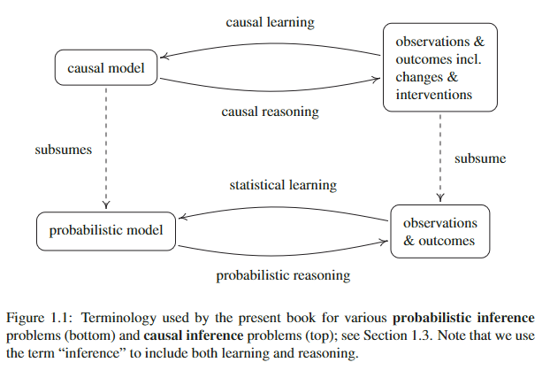
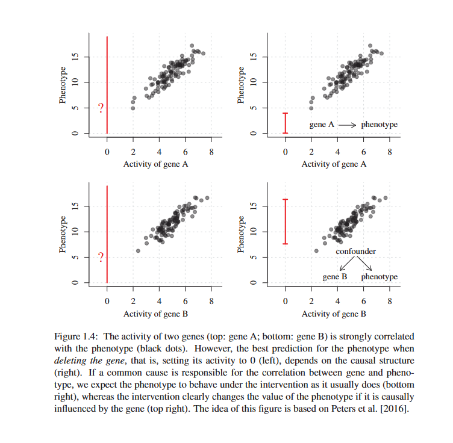

# **Estatistica e modelos causais**

## **Teorica de probabilidade X Estatisticas**

Em probabilidade já conhecemos o processo gerador, ou seja, a distribuicao verdadeira e queremos analisar os seus possiveis resultados através de experimentos com diversos parametros para gerar dados.

- Entretanto, em estatística o processo é contrário, nos temos os resultados e queremos afirmar coisas sobre o processo/distribuicao geradora em que geralmente temos tuplas ((x1,y1)...) chamadas de observacoes/linhas em que assumimos que cada uma delas sao i.i.d, ou seja, independentes e vieram da mesma distribuicao multivariada de origem chamada Pxy. O maior problema na estatistica é que desconhecemos a distribuicao real/original dos dados.
- *Joint Distribution Pxy* descreve a probabilidade de duas ou mais variáveis aleatórias ocorrerem simultaneamente dentro de intervalos ou conjuntos específicos de valores e possuem uma função de probabilidade conjunta p(x, y) = P(X = x, Y = y). Isso é equivalente a P(x intersect y) e todas as operacoes como bayes.
- *Conditional Distribution* é probabilidade de uma variável assumir um valor sabendo que a outra já assumiu um valor específico ($P(Y=y \vert{} X=x) = \frac{p(x,y)}{p_X(x)}$).

## **Learning Theory**

Investiga quando um modelo treinado/adaptado com dados empiricos (amostras) consegue se sair bem na inferencia em dados novos. Para isso ele precisa de:

- *Generalizacao:* Independente de quantas amostras (tamanho finito) temos nunca vamos conseguir mapear perfeitamente todas as saidas da funcao geradora dos dados, se agarrar muito a essa amostra pode levar a problemas de generalizacao como overfitting.
- *risco real e risco empirico:* idealmente queremos minimizar o risco/probabilidade real do nosso modelo errar porém para isso seria necessária a distribuicao de origem e portanto usamos o risco empirico buscando funcoes que minimizem ambos risco empirico e verdadeiro.
- *Capacidade:* tem que ser complexo suficiente para aprender os padroes
- *Consistente:* Se mais dados chegarem ele precisa se aproximar mais ainda do menor risco real 

## **Causal Reasoning and Learning**

Modelos causais possuem mais informacao que modelos estatisticos pois eles permitem analisarmos o efeito de alteracoes em causas. O autor distingue 2 processos diferentes mas complementares:
- Causal Reasoning/Inference: Já sabemos o modelo causal, ou seja, temos o grafo que mapeia as causas nas variaveis. Isso permite fazer operacoes de inferencia causal (Conceito: Prever efeitos de intervencoes em variaveis) através de intervencoes nas causas. 
    - Reasoning é equivalente a probabilidade na inferencia classica uma vez que em ambos já temos os modelos e apenas queremos analisar os resultados gerados por esse modelo
- Causal Learning/Discovery: Nao temos a estrutura real ainda e precisamos estimar essa estrutura usando dados. Esse segundo problema é bem mais dificil uma vez que varios grafos/modelos podem gerar a mesma distribuicao empirica, ou seja, os dados que usamos e mesmo conhecendo a distribuicao real Pxy nao é trivial dizer que X causa Y pois por exemplo nao sabemos a direcao e também pode existir uma cofounder variable nao observada nos dados.
    - Learning é equivalente a statistical learning em que tentamos aprender o modelo real através de dados empiricos gerados por ele.

### **Princípio da causa comum de Reichenbach**

- Antes de ver o principio é bom lembrar: Ser estatisticamente independente significa que a ocorrência de um evento ou o valor de uma variável não altera, influencia ou traz nenhuma informação sobre a probabilidade de outro evento ou variável acontecer

Esse principio diz que se duas variaveis aleatórias sao estatisticamente dependentes, existe uma causa que explica essa dependencia e essa causa pode ser uma das 2 variaveis ou ate mesmo uma terceira variavel. Entretanto, se conhecemos essa variavel causadora e condicionarmos nela, a relacao de dependencia some, ou seja, se fumar causa tosse, se condicionarmos agora em apenas pessoas que fumam, a tosse nao depende mais de fumar pois fumar é fixo e sem variacao. Além disso, dependencias estatisticas podem surgir de ruidos dos proprios dados e erros cometidos por pessoas.

## **Exemplos**

### **Pattern Recognition**

Imagine 2 modelos causais para um problema de digitos:

1. Rotulo -causa-> Imagem: Quem gerou os dados recebeu um rotulo e depois desenhou o digito 
    - A Imagem é gerada por uma funcao F(Rotulo, Erro)
    - Podemos intervir no rotulo e a imagem será alterada mas intervir na imagem n muda o rotulo

2. Intencao -causa-> Rotulo: quem gerou os dados pensou um pouco e decidiou ambos através de um pensamento/intencao
    L-causa-> Imagem
    - A Imagem é gerada por uma funcao G(Intencao, Erro) e o Rotulo por uma funcao H(Intencao, Erro)
    - Podemos intervir no rotulo mas isso nao altera a imagem pois ele nao causou ela

Ambos os modelos podem gerar os mesmos dados observacionais mas as intervencoes possiveis sao bem diferentes. Essa é a motivação dos modelos causais estruturais (SCMs), representar explicitamente os mecanismos que geram as variáveis, ou seja, funcoes e tudo necessário para reproduzir os dados.

### **Gene Perturbation**

Imagine agora 2 modelos causais para um problema de atividade genetica:

1. Gene A -causa-> Fenotipo
    - Se reduzirmos experimentalmente a atividade do gene A a zero, esperamos uma mudança no fenótipo, pois existe uma relação causal direta.
2. Gene C -causa-> Gene B
    L-causa-> Fenotipo
    - Nesse caso, a atividade do gene B está correlacionada ao fenótipo, mas não é sua causa. Consequentemente, intervir no gene B não altera necessariamente o fenótipo.

Os dois casos podem apresentar distribuições observacionais idênticas, embora as intervenções tenham consequências diferentes.
  

# **Causal Assumptions**

## **Principio de Mecanismos Independentes** 

Considere um exemplo com 2 variaveis: T -> temperatura e A -> altitude. Temos 2 possiveis hipoteses de causalidade:

1. A -> T, altitude causa temperatura e portanto a distribuicao conjunta P(a,t) pode ser decomposta em P(t|a) * P(a)
2. T -> A, temperatura causa altitude e portanto a distribuicao conjunta P(a,t) pode ser decomposta em P(a|t) * P(t)

È intuitivo perceber que se uma intervencao na causa for feita em ambos os modelos: No primeiro estamos mudando a altitude e devido a fatores fisicos a temperatura também vai mudar. No segundo estamos mudando a temperatura de uma cidade... isso ira fazer com que a cidade comece a voar ? ou entre debaixo da terra ? Claramente o primeiro modelo é mais representativo e isso esta ligado ao mecanismo fisico de interacao entre altitude e temperatura.

### **Premissas**

$$ 
p(a,t)=\underbrace{p(t\mid a)}_{\text{mecanismo causal   }}\underbrace{p(a)}_{\text{    distribuição da causa}}
$$

Ambos os termos sao distribuicoes de probabilidade em que uma é condicional e outra nao, essas distribuicoes sao responsaveis pela geracao dos dados das variaveis e sao chamadas de mecanismos. O primeiro termo é o mecanismo/regra de geracao do efeito (distribuição do efeito T condicionada à causa A. Sob a hipótese causal A -> T) entre causa X e outras variaveis Y que essa causa afeta. O segundo termo é o mecanismo/regra que gerou a causa, ou seja, como essa causa é gerada ou varia. Dito isso, temos algumas premissas:

- *Autonomia/Invariancia entre mecanismos:* O mecanismo do efeito e o mecanismo que gerou a causa sao autonomos, ou seja, podemos modificar um mecanismo sem necessariamente modificar o funcionamento dos demais. Portanto, podemos mudar a regra de geracao da causa (mudar a cidade e consequentemente as altitudes) sem isso afetar em nada o mecanismo do efeito (mesmas regras fisicas de temperatura).

- *Independência entre causa e mecanismo:* O mecanismo que gera a causa não fornece informações sobre o mecanismo que produz o efeito. Por exemplo, saber que 80% das cidades tem altitude maior que x nao te diz como essa altitude vai afetar a temperatura e nem se apenas ela vai afetar a temperatura.

- *Erros independente:* No modelo causal estrutural a temperatura é gerada através de um mecanismo de interacao f, com parametros A e Nt, ou seja, f(A, Nt) em que A é a altitude e Nt sao outros fatores que afetam a temperatura. A é gerado através de fatores f(Na). Idealmente Na e Nt sao independentes pois caso contrário quebra a premissa de autonomia.

    - $N_A$ e $N_T$ são variáveis de ruído (noise), também chamadas de variáveis exógenas. Elas representam fatores que influenciam uma variável, mas que não estão explicitamente modelados como suas causas.

## **Modelos Causais e processos fisicos**

### **Tempo**

O tempo fornece uma assimetria natural: causas não podem influenciar acontecimentos no passado. Entretanto, a ordem temporal não é suficiente para estabelecer causalidade. Por exemplo, mesmo que X aconteça antes de Y, isso não prova que X causa Y.

### **Ciclos**

Até aqui, consideramos principalmente estruturas causais sem ciclos:
$$
X\longrightarrow Y
$$

Entretanto, alguns sistemas apresentam retroalimentação (feedback):
$$
X\longrightarrow Y\longrightarrow X
$$

Isso pode ser representado pelas equações estruturais:
$$
X:=f_X(Y,N_X)
$$
$$
Y:=f_Y(X,N_Y)
$$

Nesse sistema, X depende de Y, enquanto Y também depende de X. O problema é que não podemos simplesmente calcular uma variável antes da outra.

Uma possibilidade é procurar um ponto de equilíbrio por iteração:
1. Escolhemos um valor inicial para Y.
2. Calculamos X a partir desse valor.
3. Utilizamos o novo X para calcular Y.
4. Repetimos o procedimento até que os valores parem de mudar.

Entretanto, a convergência não é garantida pois o sistema pode não possuir equilíbrio, possuir múltiplos equilíbrios ou não convergir pelo método iterativo.

### **Intervencoes possiveis**

O princípio dos mecanismos independentes pressupõe que podemos intervir em um mecanismo sem necessariamente modificar os demais. Na prática, algumas intervenções afetam vários mecanismos simultaneamente. Por exemplo, aumentar a temperatura de um sistema físico pode alterar também sua pressão e outras propriedades. Para determinar quais intervenções são realmente independentes, muitas vezes precisamos conhecer a estrutura causal do sistema. Porém, essa estrutura é justamente aquilo que estamos tentando descobrir. Assim, compreender os mecanismos físicos pode ser necessário para justificar nossas hipóteses causais.

# **Cause-Effect Models**

Conceitos basicos para o caso em que o modelo tem apenas duas variaveis

## **Structural Causal Models**

