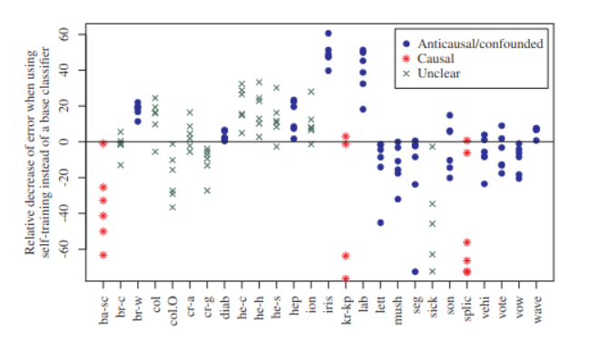

# **Learning Cause-Effect Models**

Como descobrir de X causa Y ou se Y causa X usando apenas dados observacionais ?

## **Identificabilidade da Estrutura**

O problema da identificabilidade é sobre conseguirmos ou nao definir uma UNICA direcao causal usando os dados observacionais. 

### **Por que precisamos de hipóteses adicionais?**

Sem restrições, podemos representar uma mesma distribuição P(X,Y) usando:
$$
X\longrightarrow Y
$$

ou:
$$
Y\longrightarrow X
$$

Isso acontece porque podemos construir funções estruturais e distribuições de ruído apropriadas para ambas as direções. Para conseguir distinguir as direções existem duas estratégias principais:

- *Restringir a classe dos mecanismos de SCMs:* Em vez de permitir qualquer função, exigimos que o mecanismo causal pertença a uma classe específica de funcoes que nao permita que os ruidos das duas direcoes sejam independentes.
- *Utilizar o princípio ICM:* Consideramos
    $$
    P(C,E)=P(C)P(E\mid C)
    $$

    O princípio ICM sugere que a distribuição da causa P(C) e o mecanismo $P(E\mid C)$ não devem conter informações específicas um sobre o outro, ou seja, sao independentes (mecanismos independentes)

    Na direção inversa,

    $$
    P(C,E)=P(E)P(C\mid E),
    $$

    essa independência informacional pode deixar de existir, ou seja, nao precisa ser independente. Portanto, procuramos qual fatoração apresenta maior compatibilidade com a hipótese de independência entre causa e mecanismo, ou seja, qual é mais independente. Assim, procuramos uma assimetria entre as duas fatorações para identificar a direção causal.

### **Linear Models with Non-Gaussian Additive Noise (LiNGAM)**

O modelo assume:
$$ Y=\alpha X+N_Y $$

com:
$$
N_Y\perp\!\!\!\perp X
$$

A relação entre causa e efeito é linear, e o ruído é aditivo. O Teorema 4.2 estabelece que, para uma relação não degenerada, se o modelo puder ser representado também como:
$$
X=\beta Y+N_X
$$

com:
$$
N_X\perp\!\!\!\perp Y,
$$

então a causa e o ruído precisam ser gaussianos. Portanto, se pelo menos um deles não for gaussiano, a direção causal é identificável dentro dessa classe.

### **Nonlinear Additive Noise Models (ANMs)**

Os ANMs generalizam a ideia anterior, permitindo mecanismos não lineares:
$$ Y=f(X)+N_Y $$

com:
$$
N_Y\perp\!\!\!\perp X
$$

Aqui, não exigimos que f seja linear.

## **Metodos para identificar a estrutura**

Métodos para estimar essa direção a partir de amostras finitas

### **Additive Noise Models**

O procedimento funciona com uma regressão seguida de teste de independência

Primeiro, ajustamos uma regressão:
$$
Y=\hat f(X)+R_Y
$$

O resíduo é:
$$
R_Y=Y-\hat f(X)
$$

Depois testamos:
$$
R_Y\perp\!\!\!\perp X
$$

Repetimos o processo na direção contrária:
$$
X=\hat g(Y)+R_X
$$

e verificamos:
$$
R_X\perp\!\!\!\perp Y
$$

Se apenas os resíduos da primeira regressão forem independentes da entrada, isso favorece:
$$
X\longrightarrow Y
$$

A razão é que o ANM pressupõe ruído independente da causa, e essa propriedade normalmente não se mantém na direção inversa. O livro sugere testes mais gerais, como o HSIC, capazes de detectar dependências não lineares.

### **Trace Method** 

O método utiliza a razão:
$$
r_{X\to Y}
=
\frac{\tau(A\Sigma_{XX}A^T)}
{\tau(AA^T)\tau(\Sigma_{XX})}
$$

Calculamos uma razão análoga para a direção inversa. A direção causal candidata é aquela cuja razão está mais próxima de 1. Esse valor indica maior compatibilidade com a hipótese de independência entre a matriz do mecanismo e a estrutura de covariância da causa.

### **Supervised Learning Methods**

A última abordagem transforma a descoberta causal em um problema de classificação supervisionada.

Considere dados de treinamento:
$$
(D_1,A_1),\ldots,(D_n,A_n)
$$

Cada $D_i$ é um conjunto de observações $(X,Y)$, e $A_i$ indica a direção causal conhecida.

O objetivo é treinar um classificador que aprenda características generalizadas capazes de distinguir:
$$
X\longrightarrow Y
\qquad\text{de}\qquad
X\longleftarrow Y
$$

Essas características podem incluir entropias, propriedades das distribuições e resíduos de regressões. A dificuldade é que precisamos de muitos exemplos com direções causais confiáveis, e o modelo treinado deve generalizar para novos mecanismos

# **Connections to Machine Learning I**

A direção causal entre 2 variavel pode gerar 2 problemas diferentes em ML dependendo de quem causa quem, mesmo sendo problemas conhecidos como tarefas de regressão e classificação

## **Aprendizado Supervisionado e Semi-supervisionado**

Em aprendizado supervisionado temos N pares (x,y) sob hipotese i.i.d (independentes e da mesma distribuição) e a tarefa é aprender uma função/modelo que permita prever y a partir de x (P(y|x)). Para isso usamos uma segunda função chamada loss que quantifica o erro da predição e tentamos minimizar esse erro.

- No caso supervisionado independentemente da direção causal dessas 2 variaveis, conseguimos estimar P(Y|X) com mesma eficiência 

Em aprendizado semi-supervisionado geralmente temos além dos pares (x,y) temos também instancias de (x) sem rotulos. Essas instancias sem rotulo permitem conhecer melhor a distribuição P(X). Nesse caso:

- Se X causa Y (relação causal) então sabemos o mecanismo que gerou X é P(X) e o mecanismo que gerou Y é P(Y|X). Devido ao ICM eles são informacionalment independentes e portanto conhecer mais exemplos de causa não permite inferir nada sobre P(Y|X).

    

- Se Y causa X (relação anticausal) então sabemos que o mecanismo que gerou X é P(X|Y) e o que gerou Y é P(Y). Pelo teorema de Bayes sabemos que P(Y|X) = P(X|Y)P(Y)/P(X), ou seja, aqui ter mais informação sobre a distribuição P(X) nos da informação.

    

